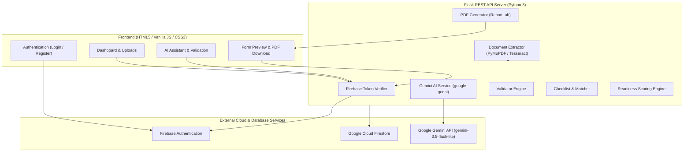

# FormWise AI – Smart AI Form Filling Assistant

> **An intelligent, bilingual (English + Tamil) educational assistant that helps first-generation and rural students understand, validate, verify supporting documents, and complete complex application forms with confidence.**

---

## 📋 Table of Contents
1. [Overview](#-overview)
2. [Key Features](#-key-features)
3. [System Architecture](#-system-architecture)
4. [Tech Stack](#-tech-stack)
5. [Directory Structure](#-directory-structure)
6. [API Endpoints](#-api-endpoints)
7. [Installation & Setup](#-installation--setup)
8. [Configuration (.env)](#-configuration-env)
9. [Running the Application](#-running-the-application)
10. [Security & Privacy](#-security--privacy)
11. [Testing & Verification](#-testing--verification)
12. [Limitations & Future Enhancements](#-limitations--future-enhancements)
13. [License & Academic Credits](#-license--academic-credits)

---

## 🌟 Overview
Filling out university admissions, scholarship applications, and government certificate forms can be intimidating, especially for students without prior administrative experience or native English proficiency. Minor mistakes often lead to form rejections, lost scholarships, or delayed admissions.

**FormWise AI** solves this problem by providing:
- **Instant Document Extraction**: Reads native PDFs, scanned PDF forms, and images using PyMuPDF and Tesseract OCR.
- **Bilingual Field Explanations**: Uses Google Gemini to detect every field and provide plain English and clear Tamil explanations with fictional examples.
- **Student Profile Autofill**: Safely transfers student details (name, DOB, email, contact, community) into matching form fields without overwriting user edits.
- **Client-Side & Server-Side Validation**: Performs rigorous format and boundary validation (phone numbers, email syntax, dates, required fields).
- **Supporting Document Checklist**: Analyzes required enclosures and verifies matches against student-uploaded supporting documents (mark sheets, community certificates, income certificates).
- **Application Readiness Scoring**: Deterministically scores application completeness from 0 to 100 with clear action items in English and Tamil.
- **PDF Preview & Generation**: Generates a clean, downloadable PDF summary of the application using ReportLab with clear submission disclaimers.

---

## 🚀 Key Features

| # | Feature | Status | Description |
|---|---|---|---|
| 1 | Student Registration & Login | ✅ Implemented & Tested | Firebase Authentication with email & password |
| 2 | Session Persistence | ✅ Implemented & Tested | Automatic token refresh & protected route navigation |
| 3 | Student Profile Management | ✅ Implemented & Tested | Firestore-backed storage of student personal & academic details |
| 4 | Protected Dashboard | ✅ Implemented & Tested | Document history, upload shortcuts, and user profile badges |
| 5 | PDF & Image Upload | ✅ Implemented & Tested | Secure uploads with magic-byte validation and 10 MB limit |
| 6 | PDF Native Text Extraction | ✅ Implemented & Tested | Fast text parsing with PyMuPDF (fitz) |
| 7 | Scanned Document OCR | ✅ Implemented & Tested | Tesseract OCR fallback for low-text scanned pages |
| 8 | Gemini AI Form Analysis | ✅ Implemented & Tested | Structured JSON schema extraction using Google Gemini |
| 9 | Bilingual Guidance (English & Tamil) | ✅ Implemented & Tested | Native Tamil script and English explanations per field |
| 10 | Automatic Field Detection | ✅ Implemented & Tested | Identifies field types: email, phone, date, number, text |
| 11 | Required vs Optional Detection | ✅ Implemented & Tested | Asterisk (*), keyword, and contextual requirement detection |
| 12 | Profile-based Autofill | ✅ Implemented & Tested | Safe autofill without overwriting student modifications |
| 13 | Manual Answer Editing | ✅ Implemented & Tested | Real-time input handling with debounced state synchronization |
| 14 | Missing-Field Detection | ✅ Implemented & Tested | Highlights empty mandatory fields with clear corrective prompts |
| 15 | Smart Answer Validation | ✅ Implemented & Tested | Regex and semantic validation with localized suggestions |
| 16 | Supporting Document Checklist | ✅ Implemented & Tested | Intelligent category matching for enclosures and certificates |
| 17 | Document Confirmation & Removal | ✅ Implemented & Tested | Student confirmation of uploaded proofs with Firestore sync |
| 18 | Application Readiness Score | ✅ Implemented & Tested | 60-point field validity + 40-point document confirmation scoring |
| 19 | Deterministic Action Items | ✅ Implemented & Tested | Human-readable next steps in English and Tamil |
| 20 | Form Preview | ✅ Implemented & Tested | Clean tabular review of all questions and filled answers |
| 21 | PDF Summary Generation | ✅ Implemented & Tested | Professional ReportLab-generated PDF document |
| 22 | PDF Download | ✅ Implemented & Tested | Attachment download with submission disclaimer |

---

## 🏗 System Architecture



---

## 💻 Tech Stack

### Frontend
- **Languages**: HTML5, CSS3, JavaScript (ES6+ Modules)
- **Styling**: Custom modern CSS design system (Inter font, responsive grid/flexbox)
- **Authentication**: Firebase Client SDK v13.3.0
- **Security**: Strict `textContent` DOM manipulation (zero `innerHTML` injection of untrusted user/AI content)

### Backend
- **Framework**: Python 3.12+ / 3.15, Flask 3.1.3, Flask-CORS
- **PDF & OCR Processing**: PyMuPDF (fitz) 1.28.2, Tesseract OCR via `pytesseract` 0.3.13, Pillow
- **AI Engine**: Google Gemini API via `google-genai` SDK 3.3.0 (`gemini-3.5-flash-lite`)
- **PDF Generation**: ReportLab 5.1.0
- **Database & Auth**: Firebase Admin SDK 7.8.0, Google Cloud Firestore

---

## 📂 Directory Structure

```
FormWise-AI/
├── .env                              # Environment configuration (server-side only)
├── .gitignore                        # Git exclusion rules
├── requirements.txt                  # Python dependencies
├── README.md                         # Project documentation
├── backend/
│   ├── app.py                        # Main Flask REST API server and routes
│   ├── gemini.py                     # Google Gemini AI integration and prompt engine
│   ├── extractor.py                  # PyMuPDF and Tesseract OCR text extraction
│   ├── validator.py                  # Deterministic field validation engine
│   ├── checklist.py                  # Document checklist builder & keyword matcher
│   ├── scoring.py                    # Application readiness scoring engine (0-100)
│   ├── autofill.py                   # Profile-to-field matching helper
│   ├── pdf_generator.py              # ReportLab filled-PDF generator
│   ├── serviceAccountKey.json        # Firebase Admin credentials
│   ├── test_step4.py                 # Backend unit & integration test suite (21 tests)
│   └── test_pdf.py                   # PDF generation & preview test suite (4 tests)
├── frontend/
│   ├── index.html                    # Public landing page
│   ├── login.html                    # Student sign-in page
│   ├── register.html                 # Student registration page
│   ├── dashboard.html                # Protected student dashboard
│   ├── upload.html                   # Document upload interface
│   ├── assistant.html                # Core AI assistant, validation & checklist UI
│   ├── preview.html                  # Form preview and PDF download page
│   ├── profile.html                  # Student profile management page
│   ├── validation.html               # Redirect bridge to assistant
│   ├── css/
│   │   └── style.css                 # Unified stylesheet
│   └── js/
│       ├── firebase.js               # Firebase client configuration
│       ├── auth.js                   # Authentication controllers
│       ├── api.js                    # API helper utilities
│       ├── upload.js                 # Upload handlers with drag-and-drop
│       ├── profile.js                # Profile Firestore management
│       └── assistant.js              # AI assistant, checklist & readiness controller
├── docs/                             # Academic reports and presentation
│   ├── project_report.md             # Complete academic project report
│   ├── presentation.md               # Seminar presentation slides
│   ├── architecture_diagram.md       # Visual architecture specification
│   ├── database_structure.md         # Firestore collection schemas
│   ├── testing_report.md             # Test execution results
│   └── final_submission_checklist.md # Final submission verification list
└── uploads/                          # User-isolated document storage (uploads/<uid>/)
```

---

## 🔌 API Endpoints

All protected endpoints require an `Authorization: Bearer <Firebase_ID_Token>` header.

| Method | Endpoint | Auth | Purpose |
|---|---|---|---|
| `GET` | `/health` | Public | Service health and Firebase connectivity check |
| `POST` | `/api/upload` | Required | Upload form PDF/image (stores in `uploads/<uid>/`) |
| `POST` | `/api/extract` | Required | Extract text from uploaded document |
| `POST` | `/api/analyse` | Required | Run Gemini AI structured field analysis |
| `POST` | `/api/validate` | Required | Deterministically validate student answers |
| `POST` | `/api/checklist` | Required | Retrieve document requirements and matches |
| `POST` | `/api/checklist/confirm` | Required | Confirm or unconfirm a matched document |
| `POST` | `/api/readiness` | Required | Compute application readiness score (0-100) |
| `POST` | `/api/preview` | Required | Get structured tabular preview of answers |
| `POST` | `/api/download-pdf` | Required | Generate and download filled-form summary PDF |

---

## ⚙️ Installation & Setup (For Teammates)

Running FormWise AI on any Windows laptop is simple and automated.

### Prerequisites (Install Once)
1. **Python 3.10, 3.11, or 3.12** from [python.org](https://www.python.org/downloads/).
   > ⚠️ **CRITICAL**: During Python installation, check the box: **"Add Python to PATH"**.
2. **Google Gemini API Key** (Free): Get one in 1 minute from [Google AI Studio](https://aistudio.google.com/app/apikey).
3. *(Optional)* **Tesseract OCR** (Only needed if uploading photos or scanned forms):
   Download the Windows installer from [UB-Mannheim Tesseract](https://github.com/UB-Mannheim/tesseract/wiki).
   Standard digital PDFs work out of the box with zero external software!

---

### Quick 2-Step Automated Setup (Windows)

#### Step 1: Run Automated Setup
Extract the project ZIP and double-click:
```cmd
setup.bat
```
This script automatically:
- Confirms Python is available.
- Creates an isolated virtual environment (`venv`).
- Creates your `.env` file from `.env.example`.
- Installs all dependencies from `requirements.txt`.
- Verifies Tesseract OCR and Firebase credential status.

#### Step 2: Add Your Gemini API Key
Open the newly created `.env` file in Notepad or VS Code and paste your Gemini key:
```env
GEMINI_API_KEY=AIzaSy...YourKeyHere
GEMINI_MODEL=gemini-3.5-flash-lite
```

#### Step 3: Run FormWise AI
Double-click:
```cmd
start.bat
```
This will:
- Start the Flask Backend on `http://127.0.0.1:5000`.
- Start the Frontend Server on `http://localhost:8000`.
- Automatically open `http://localhost:8000/index.html` in your default browser!
- When you are finished testing, simply press any key in the launcher window to cleanly stop both servers.

---

### Manual Setup (Linux / macOS / PowerShell)

```bash
# 1. Create virtual environment
python -m venv venv

# 2. Activate virtual environment
# Windows:
.\venv\Scripts\activate
# Linux/macOS:
source venv/bin/activate

# 3. Install packages
pip install -r requirements.txt

# 4. Copy environment template
cp .env.example .env
# Edit .env and insert your GEMINI_API_KEY

# 5. Run Backend (Terminal 1)
cd backend
python app.py

# 6. Run Frontend (Terminal 2)
cd frontend
python -m http.server 8000
```

---

## 🔑 Firebase Admin Credentials Setup

FormWise AI connects to Google Cloud Firestore to store student profiles, document metadata, and confirmed document matches.

### How Each Teammate Configures Firebase:
1. **Using the Team Service Account**:
   If your team lead provided you with `serviceAccountKey.json`, simply copy it into:
   ```
   backend/serviceAccountKey.json
   ```
   The backend automatically loads it from this project-relative path on any laptop!

2. **Using Your Own Firebase Project**:
   If creating your own Firebase project:
   - Go to [Firebase Console](https://console.firebase.google.com/).
   - Enable **Authentication** (Email/Password provider).
   - Enable **Cloud Firestore** in test or production mode.
   - Go to **Project Settings** -> **Service accounts** -> Click **Generate new private key**.
   - Save the downloaded JSON file as `backend/serviceAccountKey.json`.

---

## 🔧 Troubleshooting Guide for Teammates

| Problem | Cause | Quick Fix |
|---|---|---|
| `'python' is not recognized as an internal or external command` | Python was installed without PATH enabled | Re-run Python installer, choose "Modify", and check "Add Python to PATH", or restart your terminal. |
| `Analysis Error: AI analysis request was rejected` | Gemini API key missing or quota exhausted | Verify your key in `.env`. Ensure model is set to `GEMINI_MODEL=gemini-3.5-flash-lite` (free & stable). |
| `Port 5000 or 8000 already in use` | Another server is running on that port | In cmd run `taskkill /F /IM python.exe` to close old background processes, then run `start.bat`. |
| `Image OCR failed: tesseract is not installed` | Uploaded a photo or scanned PDF without Tesseract | Digital PDFs work without Tesseract. For scanned documents, install [Tesseract OCR](https://github.com/UB-Mannheim/tesseract/wiki) and ensure it's at `C:\Program Files\Tesseract-OCR\tesseract.exe`. |
| `Firestore native client unavailable` | OS gRPC policy restrictions | FormWise AI includes an automatic fallback to the Firestore REST API client—no action needed! |

---

## 🔒 Security & Privacy

1. **Strict User Isolation**:
   - Files are stored in separate directories by user UID (`uploads/<uid>/<doc_id>.<ext>`).
   - Every file access is validated with `os.path.commonpath` to prevent path traversal attacks.
   - Cross-user document viewing or matching is strictly forbidden.
2. **Untrusted Data Isolation**:
   - Extracted document text is encapsulated in delimiter blocks when sent to Gemini to prevent prompt injection.
   - Example values from Gemini are strictly fictional and never accepted as valid answers.
3. **Safe DOM Rendering**:
   - All dynamic text, field labels, explanations, and action items are inserted via `textContent` or `createEl()`. Zero usage of `innerHTML` for untrusted or AI content.
4. **Credential Protection**:
   - Secret API keys and service account credentials are kept strictly server-side and excluded in `.gitignore`.

---

## 🧪 Testing & Verification

Run the full backend test suite:
```bash
cd D:\ASTRON\FormWise-AI\backend

# Run Phase 7 Step 4 Unit & Security Tests (21 tests)
python -m unittest test_step4.py

# Run PDF Generation & Preview Tests (4 tests)
python -m unittest test_pdf.py
```

### Test Suite Summary:
- **`test_step4.py`**: 21 passed (Authentication, Rate Limiting, Ownership, Checklist, Readiness, Score Normalization)
- **`test_pdf.py`**: 4 passed (PDF Generation, Empty State, Preview Route, Download Attachment Route)
- **Syntax Verification**: 100% clean across all 8 Python modules and 6 JavaScript files.

---

## ⚠️ Limitations & Future Enhancements

### Current Limitations:
- **Free-Tier Gemini API Quota**: Free tier imposes daily request limits; `gemini-3.5-flash-lite` is prioritized as the most stable free model.
- **Scanned Document Quality**: Heavily degraded or handwritten forms rely on OCR accuracy.
- **Official Submission Boundary**: FormWise AI generates filled summaries for student review but deliberately does NOT submit directly to government or university portals.

### Future Enhancements:
- Native mobile application (Flutter / React Native).
- Multilingual support for Hindi, Telugu, and Kannada.
- Direct digital signature placeholder placement.
- Automated speech-to-text guidance for visually impaired students.

---

## 📄 License & Academic Credits
Developed as an academic final-year capstone project.  
**Project Name**: FormWise AI – Smart AI Form Filling Assistant  
**Date**: November 2026
