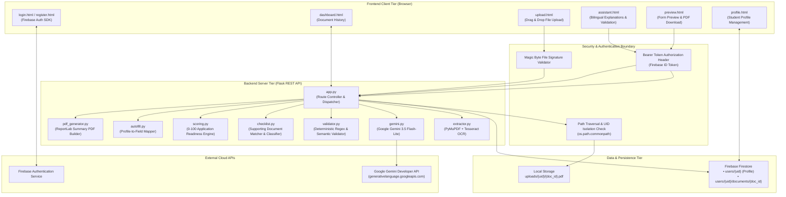
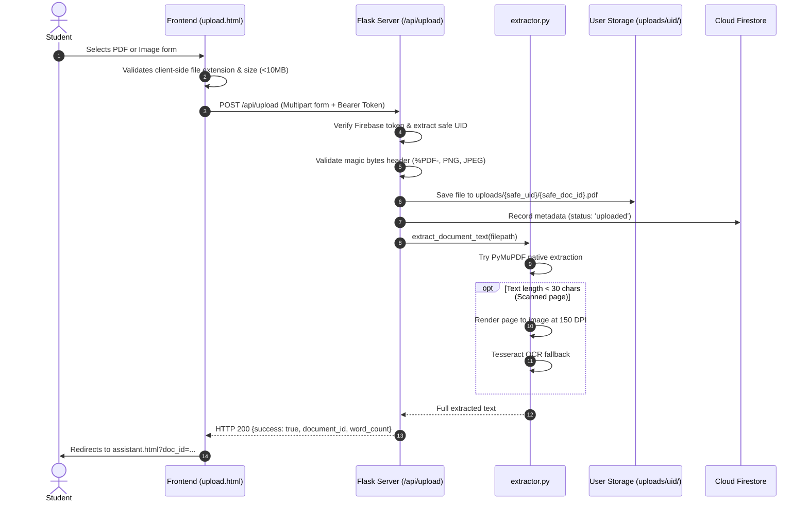
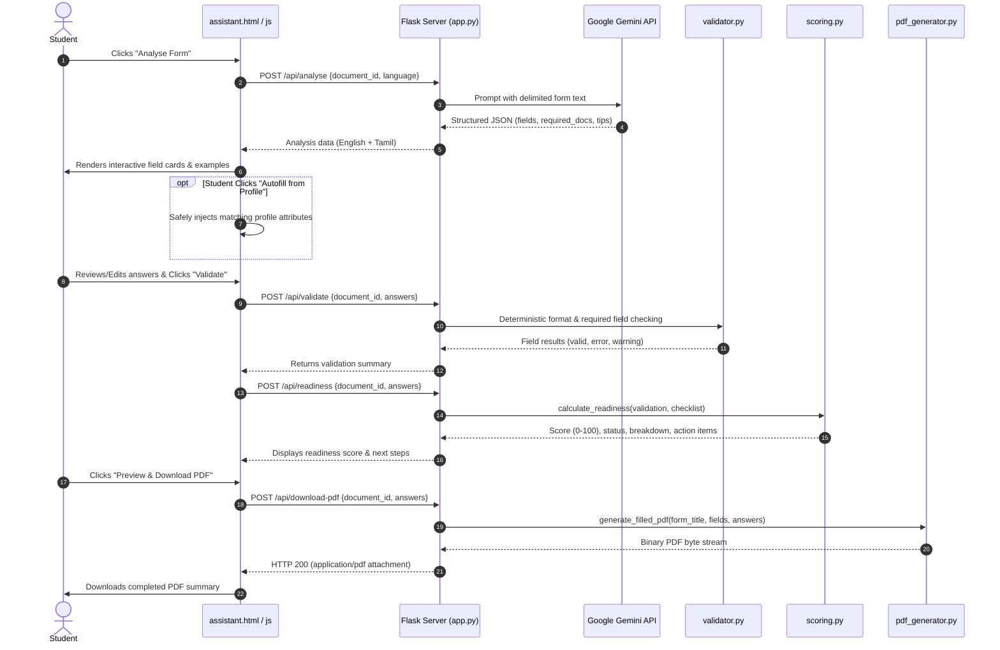

# FormWise AI – System Architecture & Data Flow

This document details the complete architectural topology, component interactions, and data flow pipelines of **FormWise AI**.

---

## 1. High-Level Architecture Diagram

---

## 2. Detailed Data Flow Pipelines

### Pipeline A: Form Upload and Extraction

---

### Pipeline B: AI Analysis, Validation, Readiness & PDF Export

---

## 3. Security Boundary Controls

1. **UID Isolation**: All uploaded documents are strictly scoped to the authenticated student's unique Firebase user identifier (`uploads/<uid>/`).
2. **Path Traversal Shield**: All file resolution is validated using `os.path.commonpath([target, user_dir]) == user_dir`.
3. **Magic Byte Verification**: Uploaded content headers are checked against standard binary signatures to prevent malicious payload disguised as PDF or images.
4. **Delimited Prompts**: Form text is encapsulated between `=== BEGIN FORM TEXT ===` and `=== END FORM TEXT ===`, preventing injected user text from escaping into instruction space.
5. **DOM Injection Immunity**: All dynamic elements on the frontend are rendered via `createEl()` and `.textContent`. Zero `innerHTML` interpolation of untrusted input.
